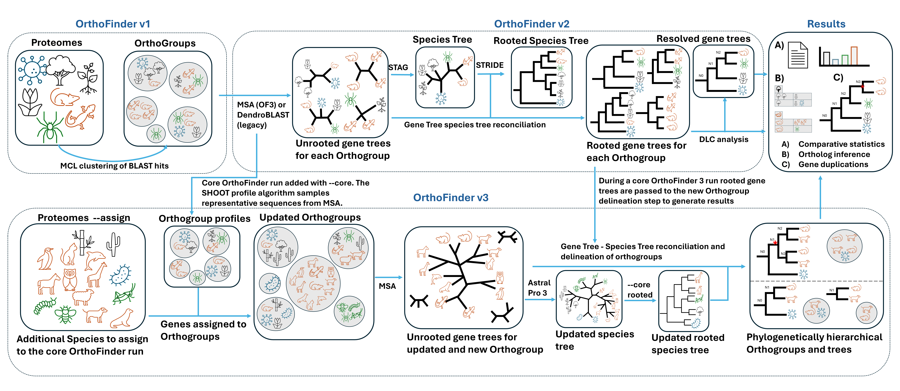
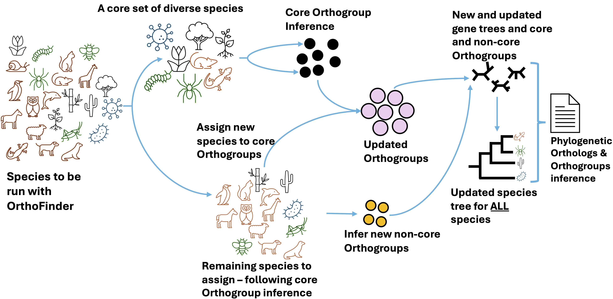
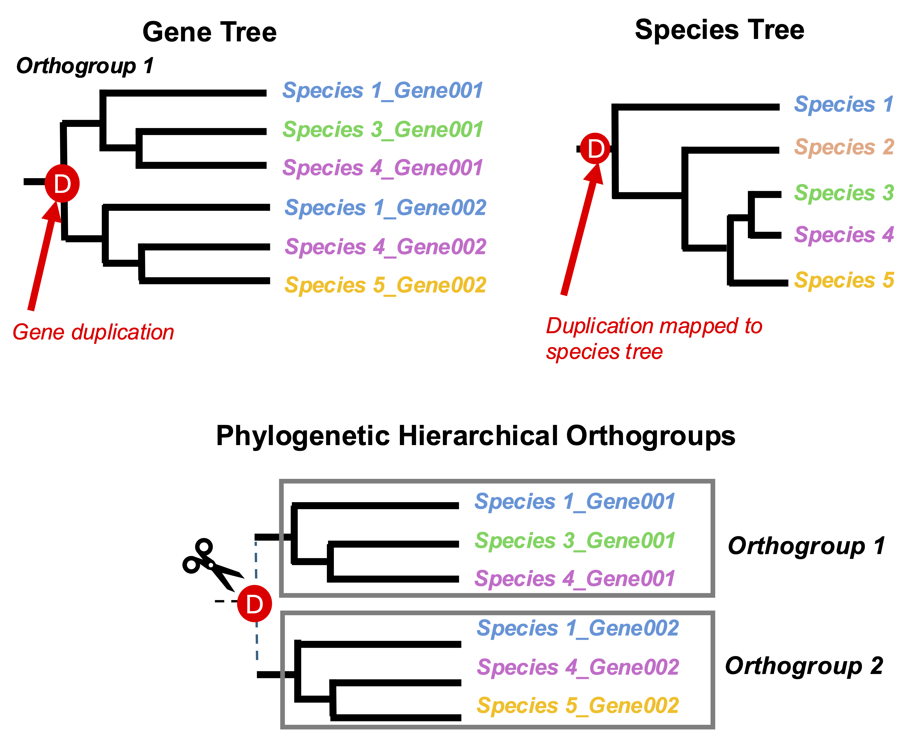

# OrthoFinder [](https://github.com/OrthoFinder/OrthoFinder/actions/workflows/orthofinder-python-main.yml)[](https://github.com/OrthoFinder/OrthoFinder/releases)


<p align="center">
  
</p>

OrthoFinder identifies orthogroups, infers gene trees for all orthogroups, and analyzes the gene trees to identify the rooted species tree. The method subsequently identifies all gene duplication events in the complete set of gene trees, and analyses them at both gene tree and species tree level. OrthoFinder further analyzes all of this phylogenetic information to identify the complete set of orthologs between all species, and provides extensive comparative genomics statistics.

> [!IMPORTANT]
> **From v3.1, `N0.tsv` is no longer in `Phylogenetic_Hierarchical_Orthogroups/`.** Its orthogroups are in `Orthogroups/Orthogroups.tsv`. If your scripts read `N0.tsv`, read `Orthogroups/Orthogroups.tsv` instead.

## Table of contents

- [What's new in v3.2](#whats-new-in-v32)
- [Installation](#installation)
- [Simple Usage](#simple-usage)
- [Advanced Usage - Scaling to Thousands of Species](#advanced-usage---scaling-to-thousands-of-species)
- [Command line Options](#command-line-options)
<!-- preview -->
- [Viewing the results in a web browser](#viewing-the-results-in-a-web-browser)
<!-- /preview -->
- [Output files](#output-files)
- [Citation](#citation)
- [System Requirements](#system-requirements)

For more information please visit [our website](https://orthofinder.github.io/OrthoFinder/).

## What's new in v3.2

These changes are in OrthoFinder v3.2 and later. Some of them change the names and files of the results: please check them if you have scripts that read OrthoFinder results.

1. **Stopping and restarting an analysis at each stage**, also for `--assign`:
   - Stop after a stage: `-op` (the search commands, written to `WorkingDirectory/blast_commands.txt`, e.g. to run on a cluster), `-og` (the MCL orthogroups, before the gene trees and the phylogenetic hierarchical orthogroups), `-ogt` (gene trees) or `-ost` (species tree). The end of the run prints the command to continue it.
   - The MCL orthogroups (before the HOGs) are written as `Orthogroups/MCL_Orthogroups.tsv` (and `.txt`, `.GeneCount.tsv`, `_UnassignedGenes.tsv`) when a run stops after a stage, or if it fails or is interrupted (Ctrl-C, a job time limit) after them. In a full run they are kept only with `-mog`. `Orthogroups.tsv` etc. are the final orthogroups, from the HOGs. Their sequences, a FASTA file for each, can be written with `mcl_orthogroup_sequences <Results_dir>`.
   - Restart from a stage: `-b` (search results), `-fg` (the MCL orthogroups: after `-og`, or from a run that went further (after `-ogt` or `-ost`, or a complete run), to infer the alignments and gene trees again, e.g. with other `-A`/`-T`), `-fgt` (gene trees) or `-fst` (species tree), given the results directory.
   - A restart writes its results to the results directory it is given, the one of the stopped run: it does not create a new one. `--assign` is different: it always creates a new results directory, next to the core run's (`--core`), and leaves the core run's results as they are. That directory can in turn be the core of another `--assign` run, to add species in several stages (e.g. `--assign <new species 2> --core <results of the first --assign>`). An `--assign` run that stopped is restarted from its new directory, and continues in it.
   - A restart continues with the settings of the run (search program, scoring, `-M`, `-A`, `-T`, `-ST`, `-I` etc., kept in `WorkingDirectory/run_state.json`), unless they are given again.
   - With `-b`, OrthoFinder runs only the searches whose results are missing or incomplete, e.g. after `-op`, or after a run that was interrupted (Ctrl-C, a job time limit) or failed. The finished searches are recorded in `WorkingDirectory/checkpoint.txt`; the results of an interrupted search are moved aside (`.incomplete`) and the search is run again.
   - With `-op`, the search commands are no longer printed to the terminal: they are written to `WorkingDirectory/blast_commands.txt`. A restart with `-b` reuses the search results that are there, and runs only the missing ones, with the search program of the run.

2. **Pairwise ortholog files only with `-pof`.** By default, the orthologs are written as one compressed file per species, `Orthologs/<species>.tsv.gz`, which takes far less space and far fewer files with many species. With `-pof`, OrthoFinder writes a file for each pair of species as before, `Orthologs/Orthologs_<species>/<species>__v__<other species>.tsv`. For the results of a run without `-pof`, `split_ortholog_files <Results_dir>` writes the pairwise files afterwards (`python tools/split_ortholog_files.py <Results_dir>` from the source code, without installing OrthoFinder: it needs only Python 3). With many species we recommend this rather than `-pof`: it can write only the files you need (`--species`, `--partners`), in parallel (`-t`), and the analysis isn't kept waiting for them.

3. **"Orthologue" is now "ortholog"**, in the names of the results and in the messages:

   | Before v3.2 | From v3.2 |
   |-------------|-----------|
   | `Orthologues/` | `Orthologs/` |
   | `Orthologues/Orthologues_<species>/` | `Orthologs/Orthologs_<species>/` (with `-pof`) |
   | `Single_Copy_Orthologue_Sequences/` | `Single_Copy_Ortholog_Sequences/` |
   | `Comparative_Genomics_Statistics/OrthologuesStats_*.tsv` | `Comparative_Genomics_Statistics/OrthologsStats_*.tsv` |
   | `Orthogroups/Orthogroups_SingleCopyOrthologues.txt` | `Orthogroups/Orthogroups_SingleCopyOrthologs.txt` |

   The contents of the files are unchanged. A restart (`-b`, `-fg`, `-fgt`, `-fst`) in results from an earlier version first renames the old names to the new ones.

4. **The default species tree differs between the core run and `--assign`.** A core run (`-f`) infers the species tree from the concatenated alignment of the single-copy orthogroups. An `--assign` run infers it from the gene trees with ASTRAL-Pro. `-ST` (e.g. `-ST astral-pro`) makes a core run infer it from the gene trees as well; the concatenated alignment is then not needed, and these two files of a core run are not written: `WorkingDirectory/Alignments_ids/SpeciesTreeAlignment.fa` (the concatenated alignment) and `Species_Tree/Orthogroups_for_concatenated_alignment.txt` (the orthogroups used for it). If you need them, write them afterwards from the results with the `species_tree_alignment` tool (in [`tools/`](tools/species_tree_alignment.py)): `species_tree_alignment <Results_dir>` (`-o <dir>` to write them elsewhere, `--species-names` to name the rows by species).

<!-- preview -->
5. **Scoring matrices and gap penalties for DIAMOND searches**: `--matrix` (e.g. `BLOSUM45`, default `BLOSUM62`), `--custom-matrix <file>` for a matrix file of your own, and `-go`/`--gapopen` and `-ge`/`--gapextend` for the gap penalties. A restart or `--assign` from the results uses the same scoring. See [Sequence search scoring options (DIAMOND)](#command-line-options).

6. **The results in a web browser**: `--tree-view` (the species tree, the resolved gene trees with their alignments, and a species tree explorer), `--stats-view` (the statistics, with interactive plots) and `--groups-view` (the genes of each orthogroup and HOG, searchable). `--view` writes all three, linked to each other, and `OrthoFinder_Results.html` to open them, a tab for each. For the results of a finished run: `view_results <Results_dir>`. The pages work offline in any recent browser, in light or dark colours. See [Viewing the results in a web browser](#viewing-the-results-in-a-web-browser).
<!-- /preview -->

7. **The orthogroups in OrthoXML format**, for other tools: `--orthoxml` writes `Orthogroups/Orthogroups.orthoxml`, the orthogroups with their HOGs nested in them: the species tree as the taxonomy, and gene duplications as paralog groups. The MCL orthogroups (e.g. with `-og`) are written as `Orthogroups/MCL_Orthogroups.orthoxml`. See [Output options](#command-line-options).

8. **Gene and species names are the same in every results file, on every OS.** A name is made once from the FASTA header (or file name, for a species), and each character a name cannot hold is replaced by `_`: spaces and tabs, `: ; ( ) , [ ] =` and quotes (`'` `"`), and for a species also `* ? < > | \ /`. E.g. `>sp|P12345|X_HUMAN Protein X` gives `sp|P12345|X_HUMAN_Protein_X`, and `Homo sapiens.fa` the species `Homo_sapiens`. The tables, gene trees, alignments, sequences, ortholog files and pages then all use the same name, every tree is standard Newick, and the tab-separated files have no quoted cells, so any program (spreadsheets, R, pandas, `cut`) reads the names as they are. The original headers are in `WorkingDirectory/SequenceIDs.txt`. A species tree given with `-s` may name the species either way (`Homo sapiens`, `'Homo sapiens'` or `Homo_sapiens`). All results files are UTF-8 text with `\n` line endings, the same bytes on Linux, macOS and Windows. Input FASTA files may be UTF-8 (with or without a byte order mark), have Windows or old Mac line endings, or (with a warning) be in Windows-1252.

## Installation

### Install in conda (recommended) 

The simplest way to install OrthoFinder is through [conda](https://anaconda.org/bioconda/orthofinder). If you're unfamiliar with conda, [this tutorial](https://www.machinelearningplus.com/deployment/conda-create-environment-and-everything-you-need-to-know-to-manage-conda-virtual-environment/) offers a beginner-friendly introduction.

```bash
conda create -n of3_env python=3.12
conda activate of3_env
conda install orthofinder
```

Alternatively, you could install via github, or download the source code and install locally.

### Install via github

```bash
python3 -m venv of3_env 
. of3_env/bin/activate
pip install git+https://github.com/OrthoFinder/OrthoFinder.git@v3.2
```

The `@v3.2` installs that release. Without it, the latest development code on the main branch is installed, and its version shows as a development version (e.g. `3.2.post1.dev4`).

### Install locally from source code

The following commands provide three ways to download the source code of OrthoFinder locally into a directory named `OrthoFinder`.
```bash
# Download via git 
git clone https://github.com/OrthoFinder/OrthoFinder.git

# or download the orthofinder-linux-intel-3.2.tar.gz and unzip it into OrthoFinder if you are on a Linux Intel machine
mkdir OrthoFinder && \
  wget -qO- https://github.com/OrthoFinder/OrthoFinder/releases/download/v3.2/orthofinder-linux-intel-3.2.tar.gz | \
  tar -xz --strip-components=1 -C OrthoFinder
```

Next, you can run the following commands to install OrthoFinder inside the of3_env virtural environment.
```bash
cd OrthoFinder
python3 -m venv of3_env # Create an virtural environment named of3_env
. of3_env/bin/activate # Activate of3_env
pip install .
```

Whether you've installed OrthoFinder directly from GitHub or downloaded and set it up locally, the OrthoFinder package will only be available within the `of3_env` virtual environment. This avoids potential conflicts with Python dependencies.

To deactivate the virtual environment when you are finished, run:
```bash
deactivate
```
To activate the virtual environment you have created, run:

```bash
. of3_env/bin/activate
```
### Test your installation

Once you have installed OrthoFinder, you can print the help information and version, and test it on the [example data](https://github.com/OrthoFinder/OrthoFinder/releases/download/v3.2/ExampleData.tar.gz).

```bash
orthofinder --help # Print out help informatioin
orthofinder --version # Check the version
orthofinder -f ExampleData # Test OrthoFinder on an example dataset - this should take a few minutes to run. 
```

### Uninstalling

To uninstall on conda:
```bash
conda deactivate
conda remove -n of3_env --all
```
To remove the virtual environment where OrthoFinder is installed:
```bash
deactivate
cd ..
rm -rf OrthoFinder
```

## Simple Usage

Run OrthoFinder on FASTA format proteomes in `<dir>`

```python
orthofinder [options] -f <dir>
```

OrthoFinder requires one FASTA file for each species. Each file should contain the complete set of protein sequences from that species' genome,  with a single representative sequence for each gene.


If your proteomes contain multiple transcript isoforms per gene, we provide the script `primary_transcript.py` to retain only the longest isoform for each gene. This script should be run before running OrthoFinder.

If you are using OrthoFinder v3.2 or later, and installed OrthoFinder into your environment, the script is installed automatically and can be run directly as `primary_transcript`. It accepts:

- a single FASTA file
- a directory containing FASTA files
- a single .tar, .tar.gz, .tgz, or .zip archive
- a directory containing archive files (.tar, .tar.gz, .tgz, .zip)

For example:
```bash
primary_transcript proteomes/
```
or 
```bash
primary_transcript proteins.fa
```
For older OrthoFinder versions, run the script manually for each FASTA file:
```bash
for f in *.fa; do
    python primary_transcript.py "$f"
done
```

## Advanced Usage - Scaling to Thousands of Species

If you are analysing >100 species, we recommend that you use the scalable implementation. The `--core --assign` workflow uses the [SHOOT](https://genomebiology.biomedcentral.com/articles/10.1186/s13059-022-02652-8) algorithm to create profiles for previously computed orthogroups, and adds new genes to these orthogroups without requiring a costly all-versus-all sequence search. Genes that cannot be assigned using the SHOOT approach are analysed using a standard OrthoFinder workflow.

Add the files for 64 species into one directory `<core>`
Add the remaining files into another directory `<additional>`

First, run OrthoFinder on the subset of 64 species

```python
orthofinder [options] -f <core>
```

Then, add the additional species to the results of the core run

```python
orthofinder [options] --assign <additional> --core <Results_Dir>
```

To choose which 64 species to include in the core, aim to capture a broad range of the evolutionary diversity of your species.

The core run infers the species tree from the concatenated alignment of single-copy orthogroups; the `--assign` run infers it from the gene trees with ASTRAL-Pro (`-ST` chooses another species tree program).

<p align="center">
  
</p>

**Note that this alternative way of running OrthoFinder requires that the core species are run using the multiple sequence alignment option. You cannot add additional species to OrthoFinder results that were run with the `-M dendroblast` option, which was the default for OrthoFinder2**


## Command-line options

Command-line options for OrthoFinder

- **Adding additional species**<br>
  | Parameter | Description                               |
  |-----------|-------------------------------------------|
  | `--assign <dir1> --core <dir2>`      | Assign species from `<dir1>` to existing orthogroups in `<dir2>`.                   |

- **Method choices**<br>
  | Parameter | Description                               | Default   | Options                                                                                     |
  |-----------|-------------------------------------------|-----------|---------------------------------------------------------------------------------------------|
  | `-M`      | Method for gene tree inference.           | `msa`     | `dendroblast`, `msa`                                                                        |
  | `-S`      | Sequence search program. `blast` is BLAST+ for either kind of input: `blastp` for protein sequences, `blastn` with `-d` (nucleotide sequences) | `diamond` (`blastn` with `-d`) | `diamond`, `diamond_ultra_sens`, `blast`, `blastp`, `blastn`, `mmseqs` |
  | `-A`      | MSA program, requires `-M msa`            | `famsa`   | `famsa`, `mafft`, `muscle`,                                                          |
  | `-T`      | Tree inference method, requires `-M msa`  | `fasttree`| `fasttree`, `fasttree_fastest`, `raxml`, `iqtree`                               |
  | `-ST`     | Species tree program, from the gene trees, requires `-M msa` | a tree of the concatenated alignment; `astral-pro` with `--assign` | `astral-pro` |
  | `-I`      | MCL inflation parameter                   | `1.2`     | usually `1.2`–`5` (larger values give smaller orthogroups; see the [MCL manual](https://micans.org/mcl/man/mcl.html)) |

<!-- preview -->
- **Sequence search scoring options (DIAMOND)**<br>
  | Parameter        | Description                                                               |
  |------------------|---------------------------------------------------------------------------|
  | `--matrix`       | Scoring matrix of the DIAMOND searches (default `BLOSUM62`): `BLOSUM45`, `BLOSUM50`, `BLOSUM62`, `BLOSUM80`, `BLOSUM90`, `PAM250`, `PAM70` or `PAM30`. |
  | `--custom-matrix` | A scoring matrix file for the DIAMOND searches (see below); requires `--gapopen` and `--gapextend`. |
  | `-go`, `--gapopen` | Gap open penalty of the DIAMOND searches (default: the matrix's, `11` for `BLOSUM62`), as DIAMOND allows for the matrix. |
  | `-ge`, `--gapextend` | Gap extend penalty of the DIAMOND searches (default: the matrix's, `1` for `BLOSUM62`), as DIAMOND allows for the matrix. |

  **Custom scoring matrices (`--custom-matrix`)**: a text file in the format of NCBI's matrices, e.g. any file from https://ftp.ncbi.nlm.nih.gov/blast/matrices/ as it is:
  ```
  # comment lines start with #
     A  R  N  D  C  Q  E  G  H  I  L  K  M  F  P  S  T  W  Y  V  B  Z  X  *
  A  4 -1 -2 -2  0 -1 -1  0 -2 -1 -1 -1 -1 -2 -1  1  0 -3 -2  0 -2 -1  0 -4
  R -1  5  0 -2 -3  1  0 -2  0 -3 -2  2 -1 -3 -2 -1 -1 -3 -2 -3 -1  0 -1 -4
  ...
  ```
  - The first line is the one-letter amino acid codes; then, for each code in that order, a line of the code and its integer score with each code of the first line.
  - The 20 standard amino acids are needed (DIAMOND would otherwise find no hits); others, such as `B`, `Z`, `X` and `*`, are optional.
  - DIAMOND has no default gap penalties for a custom matrix, so `--gapopen` and `--gapextend` are needed. Not every pair works with every matrix: if DIAMOND cannot compute its statistics for them ("The ALP library failed to compute the statistical parameters for this matrix"), try others.
  - The file can be anywhere: give its path with `--custom-matrix`. OrthoFinder checks it before the run starts, and keeps a copy with the results (`WorkingDirectory/custom_scoring_matrix.txt`) that the searches use. A restart from those results (e.g. `-b` or `--assign`) uses the same matrix without `--custom-matrix` being given again, even if the original file has since been moved or changed.
<!-- /preview -->

- **Input options**<br>
  | Parameter | Description                               |
  |-----------|-------------------------------------------|
  | `-d`      | Input is DNA sequences.                   |
  | `-s`      | User-specified rooted species tree.        |

- **Output options**<br>
  | Parameter   | Description                                                                 |
  |-----------  |-----------------------------------------------------------------------------|
  | `-X`      | Gene names without their species prefix in gene trees, alignments and Duplications.tsv. |
  | `-n <txt>`      | Name to append to the results directory.                                    |
  | `-o <txt>`      | Specify a non-default results directory.                                    |
  | `-pof`    | Save the pairwise ortholog files. With many species (a file for each pair: n × (n−1) files), we recommend running without it and then making only the files you need with the `split_ortholog_files` tool (`--species`, `--partners`, `-t`): `split_ortholog_files <Results_dir>`, or `python tools/split_ortholog_files.py <Results_dir>` from the source code without installing OrthoFinder. |
  | `--orthoxml` | Also write the orthogroups in [OrthoXML](https://orthoxml.org) format, for other tools, with their HOGs nested in them: `Orthogroups/Orthogroups.orthoxml`. The MCL orthogroups are written as `Orthogroups/MCL_Orthogroups.orthoxml`. |
  | `-mog` | Also keep the MCL orthogroups (before the HOGs) in a full run: `Orthogroups/MCL_Orthogroups.tsv` etc. They are always written with `-og`, `-ogt` or `-ost`, or if the run fails. |

<!-- preview -->
- **Viewing the results in a web browser**<br>
  | Parameter | Description |
  |-----------|-------------|
  | `--tree-view` | Also write a page to view the species tree and the resolved gene trees in a web browser, with each gene tree's alignment, and a species tree explorer: the HOGs at each node, an orthogroup's duplications and losses on the species tree, each species' genes; and all genes on the species tree, each orthogroup's gene tree where it was gained (`Resolved_Gene_Trees/Resolved_Gene_Trees.html`). |
  | `--stats-view` | Also write a page of the run's statistics with interactive plots (`Comparative_Genomics_Statistics/Statistics.html`). |
  | `--groups-view` | Also write a page of the genes of each orthogroup and HOG, searchable (`Orthogroups/Groups.html`). |
  | `--view` | All three pages, linked to each other, and `OrthoFinder_Results.html` to open them, a tab for each (also with two of them). |

  See [Viewing the results in a web browser](#viewing-the-results-in-a-web-browser) for finished runs and results on a server.
<!-- /preview -->

- **Parallel processing options**<br>
  | Parameter | Description                                 | Default |
  |-----------|---------------------------------------------|---------|
  | `-t`      | Number of parallel sequence search threads. | Half the CPU cores available (on a cluster, those of the job), at least 1 |
  | `-a`      | Number of parallel analysis threads.        | A quarter of `-t`, at least 1 |

  `orthofinder -h` shows these defaults for the computer it runs on.

- **Workflow stopping options**<br>
  | Parameter | Description                                                                 |
  |-----------|-----------------------------------------------------------------------------|
  | `-op`     | Stop after preparing input files for BLAST.                                 |
  | `-og`     | Stop after the MCL orthogroups (no gene trees, species tree or HOGs): `Orthogroups/MCL_Orthogroups.tsv` etc. |
  | `-ogt`    | Stop after gene trees.                                                      |
  | `-ost`    | Stop after the rooted species tree (STRIDE, from the gene trees).           |

- **Workflow restart options**<br>
  | Parameter    | Description                                                   |
  |--------------|---------------------------------------------------------------|
  | `-b <dir>`   | Restart OrthoFinder from pre-computed sequence search results in `<dir>`. |
  | `-fg <dir>`  | Restart OrthoFinder from MCL Orthogroups results in `<dir>`.            |
  | `-fgt <dir>` | Restart OrthoFinder from gene trees results in `<dir>`.                 |
  | `-fst <dir>` | Restart OrthoFinder from species trees results in `<dir>`.              |

  > *`<dir>` refers to the OrthoFinder results directory*

- **Other options**<br>
  | Parameter        | Description                                                               |
  |------------------|---------------------------------------------------------------------------|
  | `-1`             | Only perform one-way sequence search.                                     |
  | `-z`             | Don’t trim MSAs (columns >= 90% gap, min. alignment length 500).          |
  | `-y`             | Split paralogous clades below the root of a HOG into separate HOGs.        |
  | `-h`             | Print this help text.                                                     |
  | `-v`             | Print version.                                                     |

<!-- preview -->
## Viewing the results in a web browser

OrthoFinder can write three linked pages to explore the results, plus `OrthoFinder_Results.html` to open them in tabs:

| Page | What it shows |
|------|---------------|
| `Resolved_Gene_Trees/Resolved_Gene_Trees.html` | The species tree, each resolved gene tree with its alignment, and a species tree explorer (HOGs per node, duplications and losses) |
| `Comparative_Genomics_Statistics/Statistics.html` | The run's statistics, with interactive plots |
| `Orthogroups/Groups.html` | The genes of each orthogroup and HOG, searchable |

The pages work offline in any recent browser and scale to thousands of species: each loads only the data it shows. Gene search matches the start of a gene name.

**Write the pages**

```bash
orthofinder -f <proteomes_dir> --view            # during a run (or --tree-view, --stats-view, --groups-view)
view_results <Results_dir>                       # for a finished run (same options)
```

**Open them**

- On your own computer: open `<Results_dir>/OrthoFinder_Results.html` (Linux: `xdg-open <Results_dir>/OrthoFinder_Results.html`). Keep the results directory together: each page reads its data from the folders next to it.
- On a server or cluster: serve them and open them through an SSH tunnel:

  ```bash
  view_results <Results_dir> --serve               # on the server: prints the address and the ssh command
  ssh -N -L 8000:localhost:8000 <user>@<server>    # on your computer, then open http://localhost:8000
  ```

  `--port` sets the port (default 8000, or the next free one). The server listens only on the server itself; `--host 0.0.0.0` makes it reachable by anyone on the network, with no password.

**Without OrthoFinder installed**

`tools/view_results` works on its own and needs only Python 3 and ete4 (`pip install ete4`). Copy it (or `view_results.zip`, written by `make view_results_zip` to `dist/`) next to the results:

```bash
python view_results/view_results.py <Results_dir> [--serve]
python -m view_results <Results_dir> [--serve]               # the same, from the directory that holds view_results
python tools/view_results/view_results.py <Results_dir>      # from the OrthoFinder source directory
```

Light or dark colours: **Colours**, at the top right of each page.
<!-- /preview -->

## Output files

A standard OrthoFinder run produces a set of files describing the orthogroups, orthologs, gene trees, resolve gene trees, the rooted species tree, gene duplication events, and comparative genomic statistics for the set of species being analysed. These files are located in an intuitive directory structure.

Full details on the output files and directories can be found [here](http://orthofinder.github.io/OrthoFinder/tutorials/guide-to-results/). The directories that are useful for most users are

**```/Orthogroups```**
- `Orthogroups.tsv` is the main orthogroup file. Each row contains the genes belonging to a single orthogroup. The genes from each orthogroup are organized into columns, one per species. 
- `Orthogroups.txt` is a text file with each line showing the genes in a single orthogroup. It differs from Orthogroups.tsv in that it doesn’t show the species which each gene belongs to.
- `Orthogroups.GeneCount.tsv` is a tab separated text file that contains counts of the number of genes for each species in each orthogroup.
- `Orthogroups_SingleCopyOrthologs.txt` is a list of orthogroups that contain exactly one gene per species
- `Orthogrouops_UnassignedGenes.tsv` is a tab separated text file that contains all of the genes that were not assigned to any orthogroup.
- With `--orthoxml`, `Orthogroups.orthoxml` has the orthogroups in OrthoXML format, each with its HOGs nested in it.
- `MCL_Orthogroups.tsv` etc. are the MCL orthogroups, before the HOGs: written by a run that stops early (e.g. `-og`) or fails, or with `-mog`.

**```/Phylogenetic_Hierarchical_Orthogroups```**

OrthoFinder extends its phylogenetic approach to orthogroups, defining orthogroups for each node within the species tree. This increases the accuracy of orthogroups, and lets you perform orthogroup analyses for any clade of species in the species tree.

<p align="center">
  
</p>

- Each file is a phylogenetic hierarchical orthogroup (HOG) for a different node of the species tree.
- Each row of a file contain the genes belonging to a single orthogroup.
- Each species is represented by a single column.
- From v3.1, there is no `N0.tsv`: its orthogroups are in `Orthogroups/Orthogroups.tsv`

**```/Orthologs```**
- `<species>.tsv.gz` for each species lists its orthologs in all the other species.
- With `-pof`, each species has a sub-directory, `Orthologs_<species>`, that in turn contains a file for each pairwise species comparison, listing the orthologs between that species pair (`split_ortholog_files` writes them for the results of a run without `-pof`).

**```/Comparative_Genomics_Statistics```**
- Files containing summary statistics across all orthogroups, as well as comparisons between each pair of species.

**```/Resolved_Gene_Trees```**
- A rooted phylogenetic tree inferred for each orthogroup with 4 or more sequences and resolved using the OrthoFinder hybrid species-overlap/duplication-loss coalescent model.

**```/Species_Tree```**
- `SpeciesTree_rooted.txt` is a species tree inferred using STAG or ASTRAL-Pro.
- `SpeciesTree_rooted_node_labels.txt` is the same tree, but with nodes labels instead of support values. This labelled version is useful for interpreting and analysing the results of the gene duplication analyses.

```/Gene_Duplication_Events```
- `Duplications.tsv` has a row for each gene duplication event, with information on orthogroup in which it occured, the species that contain the duplicated gene, the node in the species tree on which the gene duplication event occured, and the support score for the gene duplication event.
- `SpeciesTree_Gene_Duplications_0.5_Support.txt` provides a summation of the above duplications over the branches of the species tree.

**```/Orthogroup_Sequences```**
- A FASTA file for each orthogroup giving the amino acid sequences for each gene in the orthogroup.


## Citation

- Latest<br>
  [1] *David M. Emms, Yi Liu, Laurence Belcher, Jonathan Holmes, Steven Kelly, 2026.* **OrthoFinder: improved phylogenetic orthology inference with enhanced accuracy and scalability.** *Nature Methods* **23**, 1327–1333. [](https://doi.org/10.1038/s41592-026-03126-6)

- Introduced the SHOOT method to perform phylogenetic gene search<br>
  [2] *Emms, D.M., Kelly, S*. **SHOOT: phylogenetic gene search and ortholog inference**. Genome Biol 23, 85 (2022). [](https://doi.org/10.1186/s13059-022-02652-8)

- Introduced the phylogenetic inference of orthologs, including rooted gene and species trees, and gene duplication events<br>
  [3] *Emms, D.M., Kelly, S*. **OrthoFinder: phylogenetic orthology inference for comparative genomics**. Genome Biol 20, 238 (2019). [](https://doi.org/10.1186/s13059-019-1832-y)

- Introduced the STRIDE method to root an unrooted species tree.<br>
  [4] *Emms DM, Kelly S*. **STRIDE: Species Tree Root Inference from Gene Duplication Events**. Mol Biol Evol. 2017 Dec 1;34(12):3267-3278. [](https://doi.org/10.1093/molbev/msx259)

- Introduced the STAG method of species tree inference<br>
  [5] *D.M. Emms, S. Kelly, 2017*. **STAG: Species Tree Inference from All Genes** bioRxiv. [](https://doi.org/10.1101/267914)

- Introduced the orthogroup inference method<br>
  [6] *Emms, D.M., Kelly, S*. **OrthoFinder: solving fundamental biases in whole genome comparisons dramatically improves orthogroup inference accuracy**. Genome Biol 16, 157 (2015). [](https://doi.org/10.1186/s13059-015-0721-2)

## System Requirements

**Operating system**

OrthoFinder runs on Linux (including WSL2 on Windows) and macOS. The programs bundled with OrthoFinder (in the `orthofinder-linux-intel` release and the source code) are for Linux on Intel/AMD (x86-64) processors; elsewhere, install them with conda (or see [Dependencies](#dependencies)).

OrthoFinder v3.2 is tested on Ubuntu 24.04, and its tests run on GitHub Actions (Ubuntu) with Python 3.11, 3.12, 3.13 and 3.14. OrthoFinder v3.1 was tested on Debian 12.9, CentOS 8, macOS 14.4.1 and macOS 13.2.1.

**Python**

Python `>=3.11`, and these packages, which pip and conda install with OrthoFinder:

| Package | Required | Tested with (v3.2) |
|---------|----------|--------------------|
| NumPy | any | 2.4.0 |
| SciPy | any | 1.16.3 |
| scikit-learn | any | 1.8.0 |
| Biopython | any | 1.86 |
| Rich | any | 14.2.0 |
| ete4 | any | 4.4.0 |
| pandas | `>=2.0` | 3.0.6 |

**Dependencies**

The programs OrthoFinder runs. Those bundled with OrthoFinder are built for Linux on Intel/AMD (x86-64) processors only, including WSL2 on Windows: there, they are used when no other copy is installed. On other systems (macOS, or ARM processors such as Apple silicon or ARM servers), install the programs yourself, e.g. with conda, which installs them all.

| Program | Used for | Bundled version | Required |
|---------|----------|-----------------|----------|
| DIAMOND | the sequence searches (default) | 2.2.8 | `>=2.1.7` |
| MCL | the orthogroups | 22-282 | |
| FAMSA | the alignments (default) | 2.5.2 | `>=2.2.3` |
| FastTree | the gene trees and species tree (default) | 2.2.0 | `>=2.1.11` |
| ASTRAL-Pro (ASTER) | the species tree with `--assign`, or `-ST astral-pro` | 1.25 | |
| FastME | the trees with `-M dendroblast` | 2.1.6.3 | |
| MAFFT | `-A mafft` | 7.526 | |
| BLAST+ | `-S blast`, `blastp`, `blastn` (and the default with `-d`) | not bundled | |
| MMseqs2 | `-S mmseqs` | not bundled | |
| MUSCLE | `-A muscle` | not bundled | |
| RAxML, IQ-TREE | `-T raxml`, `-T iqtree3` | not bundled | |

## Meet the team

OrthoFinder was developed by David Emms & Steve Kelly

Current members of the OrthoFinder team:

Yi Liu, Jonathan Holmes, Laurie Belcher

